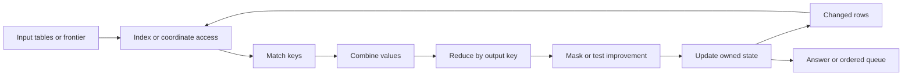

# SymFabric — symbolic workloads, operator decomposition, and architecture

SymFabric investigates shared hardware for symbolic computation. The repository already contains
executable decompositions, independent reference algorithms, work counters, CPU baseline runs and
some upstream primitive simulations. The proposed shared hardware has not yet been implemented
and validated. Expressing a workload with common operators is a different achievement from
executing it efficiently or demonstrating a hardware speedup.

This general README answers four questions in order: what the workloads calculate; which papers
decompose them and how the work changes; when GPU execution becomes inefficient; and how the
proposed architecture could execute them. It first records the actual completion status.
The explanation assumes basic programming, arrays, graphs, addition and multiplication.

**[Complete Chinese reading copy](local/general-readme.zh.md)**. Repository documentation stays
in English under [project conventions](CLAUDE.md); the Chinese counterpart stays in ignored
`local/`. Review date: 2026-10-06. Existing experimental results retain their original dates.

## Reading guide

- [0. How much has actually been done?](#status)
- [1. Workload families, mathematics and worked examples](#workloads)
- [2. Operator decomposition, papers and changes in work](#decomposition)
- [3. Why some executions are inefficient on GPUs](#gpu)
- [4. How the proposed architecture would execute them](#architecture)
- [Repository layout and reproduction commands](#repository)

<a id="status"></a>

## 0. How much has actually been done?

### 0.1 Completion has several separate meanings

| Layer | Evidence present | What that evidence establishes | Remaining limit |
|---|---|---|---|
| Mathematical/operator expression | [Value rules and relation interpreter](algebra/), [per-workload decompositions](docs/decompositions/), [evidence handbook](sym1/workload_operator_evidence.md) | The implemented kernels can be expressed using a common interface | This interface is not a new mathematical foundation; see §2 |
| Functional implementations | Each [workload](softwareworkload/) has `native`, `algebra`, and `compare`; [tests](tests/) check outputs | Two implementation paths can produce the same requested answers on tested inputs | Synthetic kernel tests do not establish complete application coverage |
| Work efficiency | [Historical traces](eval/results/20260925-203019-final6-large/workloads.json), [coverage](docs/coverage.md), §0.3 below | We know where the decomposition adds candidate generation or table processing | Some mappings inflate work substantially; expressibility is not efficiency |
| Optimized software characterization | [Validated baseline report](sym1/baseline_report.md) and raw logs | CPU graph, Datalog and sequence-DP behavior was measured on this host | Measurements cover selected kernels and inputs, not every workload |
| Existing architecture tools | SAM coordinate/intersection experiments and SCALE-Sim shape experiments in that report | Behavior of those upstream models for the tested primitive/scheduling cases | These are not complete sym1 simulation or nonlinear-arithmetic validation |
| Proposed compute/PIM architecture | [Compute model](systolicarch/), [PIM model](pim/), [research plan](sym1/README.md) | First-order exploration of mapping and possible bottlenecks | No complete sym1 cycle simulator, shared-PE RTL/PPA result or measured GPU comparison |

The latest [sym1 plan](sym1/README.md#7-repository-status-corrections-and-conventions) and
[literature audit](sym1/literature_review.md) qualify older claims in [findings](docs/findings.md).
In particular, the earlier analytical speedups are **model predictions under assumptions**.
The `tpu_like` model expands operations over dense domains; it is not an optimized GPU baseline.
An upstream repository being cloned does not mean its experiments were reproduced; the
[source inventory](sym1/upstream_status.md) explicitly separates those states.

### 0.2 The count, and what is inside it

There are eight category labels in the workload code. Logic includes fuzzy inference; the
combined graph module includes BFS and two SSSP schedules. Thus a category, a Python module,
an algorithm variant and a complete AI application are different units of coverage.
The table and case traces below are generated from local sources by
[summarize_decomposition_readme.py](eval/summarize_decomposition_readme.py).

<!-- INVENTORY -->
| CATEGORY | Modules | Count |
|---|---|---|
| automata | `automata_rpq` | 1 |
| graph | `graph_bfs_sssp`, `kg_multihop`, `triangle_count` | 3 |
| logic | `datalog_nonlinear_tc`, `datalog_samegen`, `datalog_tc`, `fuzzy_inference`, `sat_bcp` | 5 |
| parsing | `cky_parsing` | 1 |
| planning | `planning_hadd` | 1 |
| probabilistic | `bayes_net_ve`, `ctrlg_dfa_hmm`, `hmm_viterbi`, `prob_circuit` | 4 |
| search | `astar_grid`, `beam_search` | 2 |
| vsa | `vsa_cleanup` | 1 |

Source inventory: 18 modules, 8 categories.
<!-- /INVENTORY -->

Every module has an independent reference path, although some references share the same
high-level algorithm or elimination order. Independence alone is not a proof: tiny exhaustive
checks and mathematical invariants help catch a mistake shared by two implementations.
The historical test record is in [findings](docs/findings.md); this documentation review does
not claim a fresh full regression or rerun the benchmark suite.

### 0.3 How much extra work does the decomposition do?

The following is **historical measured interpreter accounting**, with ratios **derived** from
the saved integer counts at `large`, seed `0`. It is not a GPU timing measurement. One native
event can be an edge relaxation, factor product, rule application or clause visit: see
[`HOTSPOT_EVENT` in each source](softwareworkload/). A semiring “multiply” may mean AND, plus or
minimum, rather than a floating-point multiply.

```text
ratio_mul  = recorded candidate-value combinations / native hotspot events
ratio_cand = recorded tuple touches across operators / native hotspot events
```

<!-- WORK_TABLE -->
| Workload | Golden agrees | Native events | ratio_mul | ratio_cand |
|---|---|---|---|---|
| `astar_grid` | yes | 10,257 | 1.865 | 201.313 |
| `automata_rpq` | yes | 3,545,411 | 2.004 | 4.079 |
| `bayes_net_ve` | yes | 102,982 | 1.000 | 1.116 |
| `beam_search` | yes | 19,488 | 1.000 | 2.033 |
| `cky_parsing` | yes | 1,237,468 | 5.980 | 6.824 |
| `ctrlg_dfa_hmm` | yes | 224,352 | 1.056 | 1.077 |
| `datalog_nonlinear_tc` | yes | 164,033 | 71.490 | 73.555 |
| `datalog_samegen` | yes | 383,247 | 1.000 | 2.568 |
| `datalog_tc` | yes | 23,992,885 | 1.000 | 1.878 |
| `fuzzy_inference` | yes | 4,238,976 | 4.841 | 6.800 |
| `graph_bfs_sssp` | yes | 297,966 | 1.459 | 813.905 |
| `hmm_viterbi` | yes | 548,352 | 1.021 | 1.031 |
| `kg_multihop` | yes | 394,115 | 1.000 | 3.951 |
| `planning_hadd` | yes | 102,524 | 4.018 | 7.667 |
| `prob_circuit` | yes | 811,008 | 1.097 | 1.097 |
| `sat_bcp` | yes | 38,694 | 4.769 | 36.257 |
| `triangle_count` | yes | 1,572,228 | 1.616 | 2.465 |
| `vsa_cleanup` | yes | 19,275,776 | 1.125 | 1.138 |

Source SHA-256: `51d5299dbd17a95fd302880438eaa35f996c3fcd2bbc5668f99958fb60f570c0`.
<!-- /WORK_TABLE -->

Read each row against its own native algorithm. Do not average these heterogeneous events into
one universal hardware-efficiency score. Some modules execute multiple alternatives and count
the matching reference work multiple times; their aggregate ratios are not a single schedule.
`ratio_cand` also omits some real costs: combine counts matching pairs rather than every failed
hash probe/build operation, while `update` copies a Python dictionary but records delta touches.
The counters expose selected logical work, not all instructions, memory traffic or latency.

The evidence supports four different conclusions:

1. Some mappings preserve almost all hotspot work. They can still add mask, update and selection
   passes that `ratio_mul` does not show.
2. Join order matters. CKY can join child pairs before grammar rules or use rules first; RPQ can
   combine graph edges and automaton transitions in different orders. Those produce different
   intermediate tables for the same answer.
3. A round-based schedule may improve the same state repeatedly; an ordered native algorithm
   can settle it earlier. This affects fuzzy closure, relaxed planning and frontier SSSP.
4. Batch selection over an entire pending table is not a persistent priority queue. A* and
   Dijkstra may preserve edge work while paying heavily for finding/removing the next item.
   Nonlinear closure and clause scanning can add substantial algorithmic work as well.

The missing structural capabilities already identified in [the algebra audit](docs/algebra.md)
are indexed gather, grouped selection, persistent queues, early-exit clause access, fused
state updates, join planning and affine index constraints. A faster arithmetic unit alone
does not remove any of those extra operations.

<a id="workloads"></a>

## 1. Workload families, mathematics and worked examples

### 1.1 What “symbolic AI workload” means here

A symbolic computation explicitly manipulates entities and relationships: a graph vertex, a
logical fact, a grammar rule, an action prerequisite or a discrete hidden state. It can also
attach a number to each entity, such as cost, probability or confidence. Symbolic does not
mean “no floating point.” A neural model may supply these numbers, while the symbolic stage
applies a declared reasoning procedure to them.

The following is a useful classification of **this repository**, not an exhaustive taxonomy of
all AI. The same recurrence can appear in several applications. For example, graph reachability
and Datalog closure overlap; constrained decoding combines an automaton with probability DP.

Notation used below is elementary:

- `sum over i` means add one term for each allowed `i`; `product over i` means multiply them.
- `min` and `max` choose the smallest and largest candidate. `argmin`/`argmax` return its identity.
- `[condition]` is `1` when the condition is true and `0` otherwise. `AND`, `OR`, and `NOT`
  have their usual Boolean meanings.
- `∞` means no finite path/cost is known; it is not an ordinary large measured number.
- `O(f(n))` describes how work grows with input size, ignoring constant factors. It does not
  directly predict seconds. A path through dependent steps also limits parallel execution.

Each case provides its mathematical task, a worked explanation, a concrete lowering and its
scope. Generated trace blocks are **constructed teaching examples**, checked using actual
local algebra primitives against independent calculations by
[documentation_examples.py](sym1/scripts/documentation_examples.py). They illustrate specified
steps, not a new benchmark or a full workload regression. Fractions denote exact derived values.

To read a trace, `input` is the constructed input, `native` is the independent answer,
and `result` is the operator answer. A row such as `{('a','c'): 3}` has key `(a,c)` and
value `3`; `{}` is an empty table. The empty key `()` stores one scalar result, such as
a total count. `True` records an existing Boolean fact. Intermediate line names describe
the operation just performed. A line marked `WRONG` deliberately demonstrates a semantic
mistake; the Ctrl-G trace separately labels the implemented proxy and the full-task answer.

### 1.2 Logic: infer facts from other facts

#### L1. Linear Datalog transitive closure — `datalog_tc`

**Input and answer.** `E(x,y)` says there is a directed edge from `x` to `y`.
`R(x,y)` asks whether there is any **nonempty** path from `x` to `y`.

```text
R initially = E
C(x,z) = OR over y of (Delta(x,y) AND E(y,z))
Delta_next = candidates C whose pair is absent from R
R_next = R OR Delta_next; repeat until Delta_next is empty
```

`Delta` is the set of facts discovered in the previous round. Start it at `E`. For edges
`a→b` and `b→c`, matching the middle vertex `b` discovers `a→c`. Keeping `Delta` avoids
re-extending every old path in every round. An isolated vertex does not reach itself under
this nonempty-path convention; a cycle can make a self-pair reachable.

**Operators.** Rename the endpoint field to match the edge's start field; `combine` on that
field with AND values, reducing alternative middle vertices with OR; `mask(negate=True)`
removes known pairs; `update` saves new pairs; `fixpoint` repeats. **Work.** All-source BFS
has an `O(n(n+m))` upper bound for `n` vertices and `m` edges. Indexed semi-naive extension
visits matching path/edge pairs; output alone can contain `n²` pairs. A dense `n³` product
every round is a different amount of work. [Implementation](softwareworkload/datalog_tc/workload.py).

<!-- CASE:datalog_tc -->
```text
input: E=[('a', 'b'), ('b', 'c')]
native: [('a', 'b'), ('a', 'c'), ('b', 'c')]
join: {('a', 'c'): True}
new_delta: {('a', 'c'): True}
result: {('a', 'b'): True, ('a', 'c'): True, ('b', 'c'): True}
```
<!-- /CASE:datalog_tc -->

#### L2. Same-generation recursive inference — `datalog_samegen`

**Task.** Infer corresponding descendants from an initial relation `Flat(p,q)`.
`Up(x,p)` maps a child to its parent; `Down(q,y)` maps a parent to its child.

```text
S initially = Flat
S(x,y) is true if Up(x,p) AND S(p,q) AND Down(q,y) for some p,q
```

If `p` and `q` are corresponding family members, and `a` and `b` are their respective
children, derive that `a` and `b` correspond. This is the same-generation rule relative
to the supplied seed pairs, not a claim that every pair at the same tree depth is seeded.

**Operators.** `combine(Up,Delta)` creates `(child,q)` partial matches; a second `combine`
with `Down` creates child pairs; antijoin and update keep new pairs; repeat. **Work.** If
parents have `d(p)` and `d(q)` children, a parent pair can produce `d(p)d(q)` child pairs.
That cross product may be required output. Recomputing it for already processed parent
pairs is avoidable. [Implementation](softwareworkload/datalog_samegen/workload.py).

<!-- CASE:datalog_samegen -->
```text
input: Up=[('a', 'p')]; Flat=[('p', 'q')]; Down=[('q', 'b')]
native: [('a', 'b')]
up_join_delta: {('a', 'q'): True}
join_down: {('a', 'b'): True}
result: {('a', 'b'): True}
```
<!-- /CASE:datalog_samegen -->

#### L3. Nonlinear Datalog closure — `datalog_nonlinear_tc`

**Task.** Compute the same nonempty reachability answer as L1, but extend paths with paths.
“Nonlinear” means the recursive relation occurs twice in one rule; it does not mean a neural
activation or a nonlinear scalar arithmetic function.

```text
R(x,z) is true if E(x,z), or R(x,y) AND R(y,z) for some y
C = (Delta join R_new) OR (R_old join Delta)
remove known pairs, save the remaining pairs, repeat
```

In a chain `a→b→c→d`, both `a→c` and `b→d` appear before `a→d`. Different path splits can
produce `a→d` more than once; Boolean OR makes the answer correct but does not erase the
cost of generating duplicates. The old/new distinction in the two delta terms matters
for general nonlinear recursion; special transitive-closure schedules can justify a
simpler complete variant.

**Operators.** Two path joins, OR merge, antijoin, state update, feedback. **Work.** Once
closure is dense, the number of compatible triples can approach `n³`, compared with
`O(n²)` traversal work for all sources on a sparse chain. Fewer rounds can coexist with
more work per round. [Implementation and variants](softwareworkload/datalog_nonlinear_tc/workload.py).

<!-- CASE:datalog_nonlinear_tc -->
```text
input: E=[('a', 'b'), ('b', 'c'), ('c', 'd')]
native: [('a', 'b'), ('a', 'c'), ('a', 'd'), ('b', 'c'), ('b', 'd'), ('c', 'd')]
round_0_delta_join_current: {('a', 'c'): True, ('b', 'd'): True}
round_0_old_join_delta: {}
round_0_new_delta: {('a', 'c'): True, ('b', 'd'): True}
round_1_delta_join_current: {('a', 'd'): True}
round_1_old_join_delta: {('a', 'd'): True}
round_1_new_delta: {('a', 'd'): True}
round_2_delta_join_current: {}
round_2_old_join_delta: {}
round_2_new_delta: {}
result: {('a', 'b'): True, ('a', 'c'): True, ('a', 'd'): True, ('b', 'c'): True, ('b', 'd'): True, ('c', 'd'): True}
```
<!-- /CASE:datalog_nonlinear_tc -->

#### L4. Fuzzy relational closure — `fuzzy_inference`

**Task.** An edge strength lies between zero and one. A path is as strong as its weakest
edge; among paths, keep the strongest. A strength is a declared fuzzy score, not automatically
a calibrated probability.

```text
candidate(x,z) = max over y of min(strength(x,y), edge_strength(y,z))
strength_next(x,z) = max(strength_old(x,z), candidate(x,z))
```

For `a→b = 4/5` and `b→c = 1/2`, the two-hop route has strength `1/2`; it improves a
direct `a→c = 1/5`. **Operators.** Join using min, aggregate alternatives using max,
`update`, and feed improved values back. Antijoin by key would incorrectly discard the
improvement because `(a,c)` already exists. **Work.** Round execution can revisit a pair
whenever its strength improves; widest-path priority order can avoid some revisits. In
this finite-edge max-min setting, strengths come from finitely many edge levels, unlike
arbitrary real-valued recursive improvement. [Implementation](softwareworkload/fuzzy_inference/workload.py).

<!-- CASE:fuzzy_inference -->
```text
input: max-min edges={('a', 'b'): 4/5, ('a', 'c'): 1/5, ('b', 'c'): 1/2}
native: 1/2
join: {('a', 'c'): 1/2}
changed_existing_key: {('a', 'c'): 1/2}
result: {('a', 'b'): 4/5, ('a', 'c'): 1/2, ('b', 'c'): 1/2}
```
<!-- /CASE:fuzzy_inference -->

#### L5. SAT Boolean constraint propagation — `sat_bcp`

**Task.** A literal is a variable or its negation. A clause is an OR of literals; a CNF
formula is an AND of clauses. BCP extends a partial assignment with forced values.

```text
F = clause_1 AND clause_2 AND ...
clause c = literal_1 OR literal_2 OR ... OR literal_k
if a clause is unsatisfied and exactly k-1 literals are false:
    force its one remaining unassigned literal true
if all k literals are false: report conflict
```

With `(NOT a OR b)` and `(NOT b OR c)`, assigning `a=true` forces `b=true`, then `c=true`.
Two watched literals are a way to avoid checking every clause after every assignment:
revisit a clause when a watched literal becomes false, and try to move that watch to a
literal that is not false.

**Operators.** Join new false literals to affected watch records; access clause literals;
mask true/false assignments; reduce counts to find unit/conflicting clauses; choose
replacement watches; update assignments and watch state; repeat. **Work.** A complete
scan touches `L` literal occurrences per round, or `O(rL)` over `r` rounds. Watched
execution touches affected clauses and searched replacement literals; it is neither a
free constant-time operation nor equivalent to a complete scan. The local hotspot unit
is a clause visit, so its ratio is not directly a same-unit literal-operation ratio.
BCP is one kernel of a SAT solver; conflict analysis, learning and backtracking are separate.
[Implementation](softwareworkload/sat_bcp/workload.py).

<!-- CASE:sat_bcp -->
```text
input: clauses={c1: ['!a', 'b'], c2: ['!b', 'c']}; seed=a; scan-mode teaching round
native: ['a', 'b', 'c']
round_0_false_counts: {('c1', 2): 1}
round_0_new_assignments: {('b',): True}
round_1_false_counts: {('c2', 2): 1}
round_1_new_assignments: {('c',): True}
round_2_false_counts: {}
round_2_new_assignments: {}
result: {('a',): True, ('b',): True, ('c',): True}
```
<!-- /CASE:sat_bcp -->

### 1.3 Probability: aggregate uncertain alternatives

#### P1. HMM forward and Viterbi — `hmm_viterbi`

An HMM has hidden states and observed tokens. `A(i,j)` is the probability of moving from
state `i` to `j`; `B(j,o)` is the probability of observing token `o` in state `j`; `pi(j)`
is the initial state probability. The requested answer determines whether alternatives
must be added or compared.

```text
alpha_1(j) = pi(j) * B(j,o_1)
alpha_t(j) = B(j,o_t) * sum over i of alpha_(t-1)(i) * A(i,j)
P(observations) = sum over j of alpha_T(j)

best_t(j) = B(j,o_t) * max over i of best_(t-1)(i) * A(i,j)
```

Forward adds all hidden paths. Viterbi retains the best one and needs a predecessor
identifier at each step to reconstruct it. With log scores, multiplication becomes
addition and max stays max. Forward instead needs `log(exp(a)+exp(b))`, called
log-sum-exp; it is not a plain maximum.

**Operators.** Join current state weights to transitions and reduce by destination; join
the observed emission column; repeat for the sequence; store/read Viterbi backpointers.
**Work.** Enumerating paths requires `N^T` choices for `N` states and length `T`.
Vector DP requires `O(TN²)` for dense transitions and `O(Tm)` for `m` transition edges.
It retains a sequential time dependency; §2 explains the extra work of matrix-tree schedules.
[Implementation](softwareworkload/hmm_viterbi/workload.py).

<!-- CASE:hmm_viterbi -->
```text
input: post-first-emission alpha={(0,): 1/2, (1,): 1/2}; A={(0, 0): 3/4, (0, 1): 1/4, (1, 0): 1/4, (1, 1): 3/4}; next emission={(0,): 1/2, (1,): 1/4}
native: {best_path: [0, 0], best_weight: 3/16, forward: 3/8}
transition_contract: {(0,): 1/2, (1,): 1/2}
emission: {(0,): 1/4, (1,): 1/8}
all_path_weights: {(0, 0): 3/16, (0, 1): 1/32, (1, 0): 1/16, (1, 1): 3/32}
result_forward: {(): 3/8}
result_best: {(0, 0): 3/16}
```
<!-- /CASE:hmm_viterbi -->

#### P2. Bayesian-network variable elimination — `bayes_net_ve`

A Bayesian network specifies conditional probability tables on a directed acyclic graph.
A factor is simply a table indexed by a few variables. Evidence fixes observed variables.

```text
joint(x_1,...,x_n) = product over i of P(x_i | parents_of_i)
unnormalized(q) = sum over all hidden assignments of joint(q, hidden, evidence)
answer(q) = unnormalized(q) / sum over q of unnormalized(q)
```

For prior `P(A=0)=P(A=1)=1/2` and `P(B=1|A=0)=1/4`, `P(B=1|A=1)=3/4`, observation
`B=1` gives masses `1/8` and `3/8`. Dividing by `1/2` yields posterior probabilities
`1/4` and `3/4` for `A`.

**Operators.** `filter` evidence; `combine` factors containing a chosen variable;
`reduce` sums that variable out; replace the factors with the smaller result; normalize
at the end. Choosing the elimination order is currently host-side control.
**Work.** Exhaustive binary assignment enumeration has `2^n` rows. Elimination can
dramatically reduce work, but if the largest intermediate involves `w+1` variables
with `d` states, its table has `d^(w+1)` entries. A common bounded-width estimate is
`O(n d^(w+1))`, not a polynomial guarantee for arbitrary networks. The local generator
bounds factor size, which limits what its successful runs establish.
[Implementation](softwareworkload/bayes_net_ve/workload.py).

<!-- CASE:bayes_net_ve -->
```text
input: P(A)={(0,): 1/2, (1,): 1/2}; P(B=1|A)={(0,): 1/4, (1,): 3/4}
native: {(0,): 1/4, (1,): 3/4}
factor_product: {(0,): 1/8, (1,): 3/8}
eliminate_A_evidence_mass: {(): 1/2}
result: {(0,): 1/4, (1,): 3/4}
```
<!-- /CASE:bayes_net_ve -->

#### P3. Arithmetic/probabilistic circuits — `prob_circuit`

A circuit stores a reusable calculation as nodes. Leaves supply values, sum nodes mix
alternatives, and product nodes combine mandatory children.

```text
sum_node = w_1 * child_1 + ... + w_k * child_k
product_node = child_1 * ... * child_k
example: root = (2/5) * x*y + (3/5) * x*z
```

For `x=1/2`, `y=1/3`, `z=1/4`, the products are `1/6` and `1/8` and the root is `17/120`.
If `y=0`, the `xy` branch is zero; skipping that mandatory child must not turn the product
into `x`. **Operators.** Join weights to child values and reduce sums; use binary joins
for mandatory products, respecting absent-zero semantics; evaluate in dependency order.
**Work.** A compiled circuit with `E` child links takes `O(BE)` work for a batch of `B`
inputs, subject to numerical-unit costs. Compiling arbitrary logic into a small circuit
is not free or always possible. The local random arithmetic DAG is not automatically
a normalized probabilistic model: decomposability, smoothness and other task-specific
conditions must be checked before claiming likelihood, WMC or MAP semantics.
[Implementation](softwareworkload/prob_circuit/workload.py).

<!-- CASE:prob_circuit -->
```text
input: x=1/2; y=1/3; z=1/4; w1=2/5; w2=3/5
native: 17/120
mandatory_slot_product: {('xy',): 1/6, ('xz',): 1/8}
result: {(): 17/120}
if_y_zero_safe_product: {('xz',): 1/8}
```
<!-- /CASE:prob_circuit -->

#### P4. HMM × DFA constrained decoding — `ctrlg_dfa_hmm`

A DFA stores which constraint state a token prefix reaches. `delta(s,v)` is the state
after token `v`. Combine it with HMM state `h` to track a product state `(h,s)`.

```text
f_next(h2,s2) = sum over h,s of
    f(h,s) * A(h,h2) * B(h2,v) * [delta(s,v)=s2]

local_score(v) = sum over h,s,h2 of
    f(h,s) * A(h,h2) * B(h2,v) * [delta(s,v) can reach acceptance]
```

**Operators.** Reverse-automaton Boolean reachability computes live states; probability
joins and reductions process the prefix; a live-state mask filters next-token candidates.
For one fixed prefix in a deterministic automaton, only its single DFA state is active;
the full Cartesian state space need not be dense.

**Essential limit.** Reachability says a completion exists, not how probable it is or whether
it fits the remaining length. A full finite-horizon constraint probability additionally uses:

```text
beta_0(h,s) = [s is accepting]
beta_r(h,s) = sum over h2,v of
    A(h,h2) * B(h2,v) * beta_(r-1)(h2,delta(s,v))
```

Missing transitions contribute zero. At the sequence boundary, the first-emission convention
must match the HMM. Multiply next-token contributions by the appropriate remaining-length
`beta`, then normalize. For independent token probabilities `P(a)=3/4`, `P(b)=1/4`, requiring
exactly `aa` or `bb` yields masses `9/16` and `1/16`, hence first-token probabilities `9/10`
and `1/10`. The local liveness proxy instead gives `3/4` and `1/4`.
The trace explicitly contrasts these tasks. It does not claim the full backward algorithm
is implemented in the workload. **Work.** For explicit DFA token transitions `D`, straightforward
backward DP can cost `O(RN²|D|)` before factoring/reuse; this is different from the fixed-prefix
local workload and remains strongly shape dependent.
[Implementation](softwareworkload/ctrlg_dfa_hmm/workload.py), [full-scope discussion](sym1/README.md).

<!-- CASE:ctrlg_dfa_hmm -->
```text
input: one hidden state; P(token)={a: 3/4, b: 1/4}; accept aa|bb; remaining length=2
native: {('a',): 9/10, ('b',): 1/10}
LOCAL_liveness_proxy: {('a',): 3/4, ('b',): 1/4}
completion_beta: {('a',): 3/4, ('b',): 1/4}
exact_unnormalized: {('a',): 9/16, ('b',): 1/16}
result_exact: {('a',): 9/10, ('b',): 1/10}
```
<!-- /CASE:ctrlg_dfa_hmm -->

### 1.4 Graph and knowledge-graph reasoning

#### G1. BFS and weighted shortest paths — `graph_bfs_sssp`

**BFS** minimizes the number of edges. **SSSP** minimizes the sum of edge costs from one
source. In the nonnegative-weight setting used here:

```text
distance(source)=0; all other distances=∞
candidate(v) = min over edges u→v of distance(u)+weight(u,v)
distance_next(v) = min(distance_old(v),candidate(v))
```

For `a→b=2`, `b→c=1`, `a→c=5`, BFS reaches `c` in one hop but the cheapest path costs
`2+1=3` using two hops. **Operators.** BFS uses a Boolean frontier join, a visited mask
and update. Frontier SSSP joins improved distances with edges and saves lower costs.
Dijkstra instead selects the smallest pending distance and settles one vertex before
expanding its edges. **Work.** BFS is `O(n+m)` with indexed adjacency; binary-heap Dijkstra
has an `O((n+m) log n)` bound. Frontier relaxation can revisit edges across rounds. A
batch scan for every minimum adds work beyond heap Dijkstra. These are alternative
schedules, not consecutive stages of one algorithm.
[Implementation](softwareworkload/graph_bfs_sssp/workload.py).

<!-- CASE:graph_bfs_sssp -->
```text
input: edges={('a', 'b'): 2, ('a', 'c'): 5, ('b', 'c'): 1}; source=a
native: {BFS_hops(c): 1, SSSP_distance(c): 3}
BFS_first_frontier: {('b',): True, ('c',): True}
SSSP_first: {('b',): 2, ('c',): 5}
SSSP_second: {('c',): 3}
changed: {('c',): 3}
result: {('b',): 2, ('c',): 3}
```
<!-- /CASE:graph_bfs_sssp -->

#### G2. Weighted knowledge-graph paths — `kg_multihop`

A knowledge graph contains labelled edges `(head, relation, tail)`. The local task keeps
the best multiplicative edge-weight path from each query source under a hop bound.

```text
score_next(q,v) = max over allowed edges u→v of
    score_current(q,u) * edge_weight(u,v)
log_score_next(q,v) = max over u of log_score(q,u)+log_weight(u,v)
```

For the best path within the hop bound, retain the maximum of the old score and each
new candidate; the frontier carries only genuine improvements. Scores for exactly one
specified hop count instead require separate layers.

For log weights `a→b=-1`, `b→c=-2`, `a→c=-4`, the two-hop score `-3` beats `-4`.
**Operators.** Frontier-to-edge join; max reduction by `(query,destination)`; improving-value
update; bounded feedback; final per-query selection. **Work.** About `O(QHm)` for `Q`
queries, `H` rounds and `m` edges in a full-edge scan; sparse frontiers can visit fewer
matches. Final grouped ranking also costs work. This scalar path kernel omits learned
vector messages, training and full NBFNet behavior. Edge weights are not automatically
probabilities of independent events. [Implementation](softwareworkload/kg_multihop/workload.py).

<!-- CASE:kg_multihop -->
```text
input: log-edge weights={('a', 'b'): -1, ('a', 'c'): -4, ('b', 'c'): -2}; source=a; hop limit=2
native: -3
first: {('b',): -1, ('c',): -4}
second: {('c',): -3}
changed: {('c',): -3}
result: {('b',): -1, ('c',): -3}
```
<!-- /CASE:kg_multihop -->

#### G3. Triangle counting — `triangle_count`

Orient each undirected edge from lower to higher `(degree,id)` rank; rename this ordering
as `a<b<c`. A triangle is counted once:

```text
triangles = sum over a<b<c of E(a,b)*E(b,c)*E(a,c)
E is 1 for an oriented edge, otherwise 0
```

Edges `a→b`, `b→c`, `a→c` form one triangle. **Operators.** Join two edge tables to form
two-hop wedges; mask by the closing edge; reduce with integer addition. A fused alternative
first counts wedges per endpoint pair. **Work.** The wedge join generates
`sum over v of indegree(v)*outdegree(v)` candidates in that orientation. An optimized native
algorithm can intersect oriented neighbor sets instead. Both calculate the same number;
their candidate counts need not match. Building all wedges can be much larger than the
triangle output. [Implementation](softwareworkload/triangle_count/workload.py).

<!-- CASE:triangle_count -->
```text
input: oriented E=[('a', 'b'), ('a', 'c'), ('b', 'c')]
native: 1
wedges: {('a', 'b', 'c'): 1}
closed: {('a', 'b', 'c'): 1}
result: {(): 1}
```
<!-- /CASE:triangle_count -->

### 1.5 Ordered search

#### S1. A* grid search — `astar_grid`

`g(v)` is the best path cost found so far; `h(v)` estimates the remaining cost; A* expands
the pending vertex with minimum `f(v)=g(v)+h(v)`. A grid with unit-cost horizontal/vertical
movement uses Manhattan distance:

```text
h(v) = abs(x_v-x_goal) + abs(y_v-y_goal)
choose v with minimum f(v)
for each free neighbor u: candidate_g(u)=g(v)+1
keep a lower g(u), then insert/update f(u)=g(u)+h(u)
```

The grid heuristic is consistent: one move cannot reduce `h` by more than its cost. This
supports the local closed-state policy; an arbitrary inconsistent heuristic may require
reopening states. For a starting `f=2`, `h=2`, recover `g=0`; its neighbors with `h=1`
get `f=1+1=2`.

**Operators.** Select, remove the selected key, scan score fields, join outgoing edges and
heuristics, mask settled vertices, update pending state. **Work.** A heap pays logarithmic
queue work per update/pop. Repeated batch selection over pending sizes `p_1,...,p_r` visits
`p_1+...+p_r` entries, which can grow quadratically. Hardware cannot remove the dependence
on the result of each preceding expansion. [Implementation](softwareworkload/astar_grid/workload.py).

<!-- CASE:astar_grid -->
```text
input: open f={('s',): 2}; h={a: 1, b: 1, g: 0, s: 2}; outgoing edges={('s', 'a'): 1, ('s', 'b'): 1}
native: {('a',): 2, ('b',): 2}
select: {('s',): 2}
recover_g: {('s',): 0}
neighbor_g: {('a',): 1, ('b',): 1}
result_next_open_f: {('a',): 2, ('b',): 2}
```
<!-- /CASE:astar_grid -->

#### S2. Beam decoding — `beam_search`

Keep only `K` candidate prefixes after each token step. A prefix identity includes its
history; two prefixes ending in the same token remain distinct candidates.

```text
candidate_score(prefix+v) = score(prefix)+log P(v | prefix)
next_beam = K highest scoring expanded prefixes
```

The local model is a sparse Markov token-transition model, so its probability depends on
the final token rather than a whole Transformer state. Prefix scores `-1` and `-2`
extended by a token with transition score `-2` produce `-3` and `-4`; both can survive.
Merging them only by the final token would lose a candidate.

**Operators.** Join beam rows and successors; global top-k; reindex survivors; repeat.
Host control still sorts survivor ranks and stores/reads parent maps. **Work.** With `s`
successors per prefix and length `T`, expansions cost `O(TKs)`; a bounded-heap selection
can add `O(TKs log K)`. Beam pruning reduces work relative to exhaustive `s^T` sequences
but sacrifices global optimality. Hardware must preserve that approximation contract.
[Implementation](softwareworkload/beam_search/workload.py).

<!-- CASE:beam_search -->
```text
input: beam log scores={('p', 'x'): -1, ('q', 'y'): -2}; transition log scores={('x', 'w'): -5, ('x', 'z'): -2, ('y', 'z'): -2}; K=2
native: [[-3, z, p], [-4, z, q]]
candidates_with_parent: {('w', 'p'): -6, ('z', 'p'): -3, ('z', 'q'): -4}
result: {('z', 'p'): -3, ('z', 'q'): -4}
WRONG_collapsing_parent: {('w',): -6, ('z',): -3}
```
<!-- /CASE:beam_search -->

### 1.6 Planning — `planning_hadd`

An action has preconditions, add effects and a cost. The local kernel estimates the cost
of goals under **delete relaxation**: applying an action does not remove facts. For facts
already true, cost is zero; otherwise start at infinity.

```text
h_add_next(p) = min(h_add_old(p), min over actions a adding p of
    (cost(a) + sum over preconditions q of h_add_old(q)))
h_max_next(p) = min(h_max_old(p), min over actions a adding p of
    (cost(a) + max over preconditions q of h_max_old(q)))
```

An action requiring facts of costs `2` and `3` and costing `1` gives candidate goal costs
`6` for h-add and `4` for h-max. For several goals, h-add sums and h-max takes the maximum.
An empty prerequisite set contributes zero. H-add may double-count shared effort; these
numbers are heuristic estimates, not necessarily a realizable plan cost.

**Operators.** Join fact costs to action prerequisites; check every required prerequisite
is available; sum or max by action; add action cost; join add effects; take minimum per
fact and feed improvements back. **Work.** Round evaluation can repeatedly recompute an
action; a native priority/counter schedule can process prerequisites incrementally.
H-max is **not** just min-max bottleneck arithmetic: it uses max across prerequisites,
then **addition** for the action cost. A mapper needs those distinct stages.
[Implementation](softwareworkload/planning_hadd/workload.py).

<!-- CASE:planning_hadd -->
```text
input: costs={('p',): 2, ('q',): 3}; act: p AND q -> g; action cost=1
native: {hadd(g): 6, hmax(g): 4}
join_all_preconditions: {('act', 'p'): 2, ('act', 'q'): 3}
sum_fold: {('act',): 5}
max_fold: {('act',): 3}
result_hadd: {('g',): 6}
result_hmax: {('g',): 4}
```
<!-- /CASE:planning_hadd -->

### 1.7 Automata / regular path queries — `automata_rpq`

A regular path query asks which graph destinations can be reached by an edge-label
sequence accepted by an automaton. A product state combines graph vertex `v` and
automaton state `s`:

```text
next(w,t) = OR over v,s,label of
    reached(v,s) AND graph_edge(v,label,w) AND transition(s,label,t)
answer(w) = OR over accepting t of reached(w,t)
```

For regex `xy`, graph edges `a -x→ b -y→ c` and automaton transitions
`s0 -x→ s1 -y→ s2` produce `(a,s0)→(b,s1)→(c,s2)` and answer `c`.

**Operators.** Join graph and automaton edges on labels, or join the frontier to one
operand first; reduce new product states; antijoin visited states; update; repeat;
filter accepting states and project destinations. **Work.** There can be `nS` product
states for `n` graph vertices and `S` automaton states. Product-edge size is
`sum over labels l of |graph_edges_l|*|automaton_edges_l|`; the reachable portion can be
smaller. Materializing the whole product unnecessarily can inflate work. The local
regex construction uses an epsilon-free automaton; general epsilon transitions require
additional closure handling. [Implementation](softwareworkload/automata_rpq/workload.py).

<!-- CASE:automata_rpq -->
```text
input: G=[[a, x, b], [b, y, c]]; automaton=[[s0, x, s1], [s1, y, s2]]; accept=s2; source=a
native: ['c']
product_edges: {('a', 's0', 'b', 's1'): True, ('b', 's1', 'c', 's2'): True}
first: {('b', 's1'): True}
second: {('c', 's2'): True}
result: {('c',): True}
```
<!-- /CASE:automata_rpq -->

### 1.8 Grammar parsing — `cky_parsing`

A binary grammar rule `A→BC` says a phrase of type `A` consists of adjacent phrases of
types `B` and `C`. `inside(i,j,A)` is the total weight of parses of tokens from `i` up
to, excluding, `j`.

```text
inside(i,i+1,A) = weight(A→token_i)
inside(i,j,A) = sum over splits k and rules A→BC of
    weight(A→BC)*inside(i,k,B)*inside(k,j,C)
```

Replace the sum over alternatives by max to get the best parse score. For `a b`, lexical
types `(A or C)` and `(B or D)` create four child-type pairs, but grammar rules
`S→AB` of weight `3/5` and `S→CD` of weight `2/5` allow only two. Their inside sum is `1`;
their best weight is `3/5`.

**Operators.** Match adjacent chart spans, grammar-rule fields and length constraints;
multiply child/rule contributions; reduce splits and alternatives; save new chart cells
in increasing span length. **Work.** Textbook indexed binary CKY has `O(n³|G|)` work and
`O(n²N)` chart storage for sentence length `n`, binary rules `G`, and `N` nonterminals.
Sparse rules/active cells can reduce actual work. Rule-first joins avoid many invalid
child pairs; joining every adjacent pair before filtering each length adds avoidable
work. The local kernel returns inside/best scores; a complete parse tree needs traceback.
[Implementation](softwareworkload/cky_parsing/workload.py).

<!-- CASE:cky_parsing -->
```text
input: sentence=a b; left lexical={(0, 1, 'A'): 1, (0, 1, 'C'): 1}; right lexical={(1, 2, 'B'): 1, (1, 2, 'D'): 1}; rules={('S', 'A', 'B'): 3/5, ('S', 'C', 'D'): 2/5}
native: {inside(S): 1, viterbi_probability(S): 3/5}
child_pairs: {(0, 2, 'A', 'B'): 1, (0, 2, 'A', 'D'): 1, (0, 2, 'C', 'B'): 1, (0, 2, 'C', 'D'): 1}
rule_matches: {(0, 2, 'A', 'B', 'S'): 3/5, (0, 2, 'C', 'D', 'S'): 2/5}
result_inside: {(0, 2, 'S'): 1}
```
<!-- /CASE:cky_parsing -->

### 1.9 Vector symbolic computation — `vsa_cleanup`

Represent a symbol by a long vector. Binding attaches a role by elementwise multiplication;
bundling adds vectors; cleanup chooses the codebook vector with the largest similarity.

```text
object[d] = sum over attributes i of key_i[d]*symbol_(i,value_i)[d]
scene[d] = sum over slots j of slot_j[d]*object_j[d]
query[d] = scene[d]*slot_target[d]*key_target[d]
similarity(k) = sum over coordinates d of query[d]*codebook_k[d]
answer = index k with largest similarity(k)
```

Here `[d]` denotes a vector coordinate, not a Boolean indicator. Bipolar keys contain
`+1`/`-1`, so each key coordinate squared is `1`; multiplication can undo its own binding.
For one symbol `(1,0)` and role key `(-1,1)`, binding gives `(-1,0)` and unbinding gives
`(1,0)`. In a scene with several items, unbinding also leaves cross-talk from the others;
cleanup is approximate recovery, not guaranteed exact algebraic inversion.

**Operators.** Gather symbol vectors with joins; bind; reduce to bundle; gather a scene;
unbind; dot-product join/reduce against a codebook; select the best code per query.
**Work.** Cleanup costs `O(QKD)` for `Q` queries, `K` candidate symbols and dimension `D`,
plus encoding work. This is genuinely regular dense arithmetic and can suit GPU GEMM
when batched. It is a VSA subtask, not the whole Raven/NVSA application.
[Implementation](softwareworkload/vsa_cleanup/workload.py).

<!-- CASE:vsa_cleanup -->
```text
input: orthogonal teaching codebook={('x', 0): 1, ('y', 1): 1}; bipolar key={(0,): -1, (1,): 1}; one object/slot
native: {x: 1, y: 0}
bind: {(0,): -1}
unbind: {(0,): 1}
dot_similarity: {('x',): 1}
result: {('x',): 1}
```
<!-- /CASE:vsa_cleanup -->

<a id="decomposition"></a>

## 2. Operator decomposition, papers and changes in work

### 2.1 What exactly is being decomposed?

There are three levels. **Application decomposition** separates neural perception, reasoning
and readout. **Algorithm decomposition** expresses reasoning as joins, reductions, state
changes and loops. **Physical decomposition** implements a join as coordinate/index access,
key comparisons, value operations, buffering and writes. A claim at one level does not
establish the others. These operators also are not matrix low-rank factorization: we are
rewriting an algorithm as executable steps, with no assumption of reduced matrix rank.

A weighted relation is a table whose key identifies a row and whose value carries truth,
cost or weight. For example, `(source=a,destination=c,value=3)` can encode a distance.
A join matches shared fields. A reduction merges rows after dropping a field:

```text
ordinary arithmetic: output(x,z) = sum over y of R(x,y)*S(y,z)
reachability:        output(x,z) = OR over y of R(x,y) AND S(y,z)
shortest paths:      output(x,z) = min over y of R(x,y)+S(y,z)
fuzzy closure:       output(x,z) = max over y of min(R(x,y),S(y,z))
```

The matching structure is similar; value operations differ. A **semiring** packages the two
rules: how to combine pieces needed together and how to merge alternatives. The name does
not remove costs of coordinate matching, state control or nonlinear numerical functions.
For probabilities, summing alternatives is valid only under the model's correct factorization
and disjoint-assignment interpretation; arbitrary overlapping proof probabilities cannot
simply be added. Provenance may require proof/event representations rather than scalar values.

### 2.2 The actual local operator interface

| Operator | Elementary meaning | Example / cost issue |
|---|---|---|
| `rename` | Change a field name without moving table data | Rename path endpoint to match edge start |
| `combine` | Match shared keys, combine values, optionally merge equal output keys immediately | Join path and edge; hash/index work still exists |
| `reduce` | Group on retained fields and fold values | Sum contributions to one destination |
| `filter` | Keep rows satisfying a local predicate | Retain evidence value or accepting state |
| `mask` | Keep keys present in another table; negation keeps absent keys | Discard previously visited BFS vertices |
| `update` | Merge candidates into saved state and return changed rows | Lower a distance that already existed |
| `select_k` | Keep the best `k` rows of a batch | Beam survivors; currently not a persistent heap |
| `scan` | Apply a bounded per-row transformation or re-key | Form an endpoint; cannot hide an arbitrary solver |
| `iterate` / `fixpoint` | Fixed-count repetition / feedback until no valid change remains | Sequence steps / Boolean closure |

`combine(...,keep=...)` fuses matching and aggregation; `reduce` need not create a separate
intermediate for every use. With no shared fields, `combine` forms a Cartesian product.
`mask` tests support, not values. `update` returns each changed row's **new total**, not its
arithmetic difference. Ordinary probability/counting must track contributions without
re-adding old derivations. A finite Boolean fixed point terminates because only finitely
many facts can be added; a general weighted recursion needs its own convergence argument.

Zero suppression also has a concrete consequence. In a probability product `x*y`, an absent
`y=0` must make the result zero. Multiplying only stored group members would wrongly return
`x`. Use complete mandatory-child joins or explicitly check group completeness. Numerical
change detection in `update` uses a tolerance; very small additive contributions can be lost.
See [exact semantics and known gaps](docs/algebra.md), [operator code](algebra/ops.py).

### 2.3 Mathematical and algorithmic papers

The following papers establish particular mechanisms. They do not collectively prove that
every local operator or schedule is efficient. Work formulas below are **local derivations**
under the stated assumptions, not copied experimental speedups.

| Primary source and reading location | What is decomposed into what? | Representation | Effect on work |
|---|---|---|---|
| [Green et al., Provenance Semirings, PODS 2007](https://www.cs.ucdavis.edu/~green/papers/pods07.pdf), §3 definitions, §5 recursion | Annotated relational queries → join, projection, union and selection | Tables annotated by semiring values, including provenance polynomials | Gives common semantics, not automatic savings; explicit provenance can grow |
| [Aji & McEliece, The Generalized Distributive Law, 2000](https://www.cs.ubc.ca/~murphyk/Teaching/Papers/GDL.pdf), §II–IV | Product-of-functions aggregation → local combination and marginalization/message passing | Factor tables and junction-tree-style structure | Reuses partial results; intermediate scope determines remaining exponential cost |
| [Abo Khamis, Ngo & Rudra, FAQ, PODS 2016](https://arxiv.org/abs/1504.04044), FAQ definition and InsideOut | Aggregate queries → ordered variable elimination with joins and aggregations | A factor/query hypergraph and legal elimination order | Different orders change intermediate size; mixed aggregates restrict reordering |
| [Goodman, Semiring Parsing, 1999](https://aclanthology.org/J99-4004/), §1 and framework | Weighted parsing deductions → combine antecedents and aggregate alternative deductions | Chart items, inference rules and value algebra | Shares subparses; changing value rules changes the requested result |
| [Eisner et al., Dyna, 2005](https://aclanthology.org/H05-1036/), §4.2, Fig. 3 | Weighted DP → indexed chart, agenda and change propagation | Weighted deduction rules plus scheduled increments | Relevant updates avoid some recomputation; increment semantics must match |
| [Mohri, Semiring Frameworks and Algorithms for Shortest-Distance Problems, 2002](https://cs.nyu.edu/~mohri/pub/jalc.pdf), generic shortest-distance algorithm | Path computation → path extension, aggregation and a queue discipline | Weighted graph and pending agenda | Queue policy affects revisits and convergence; algebra alone does not set work |
| [Abo Khamis et al., Convergence of Datalog over (Pre-) Semirings](https://arxiv.org/abs/2105.14435), convergence results | Recursive weighted rules → algebraic fixed-point evaluation | Datalog with declared value-domain conditions | Explains when iteration terminates; it is not a universal termination guarantee |

**Why distributivity saves work.** In a chain `P(a,b,c)=f(a,b)*g(b,c)` with `d` values for
each variable, a direct sum over all triples visits `d³` assignments. If only total mass is
needed, compute `left(b)=sum_a f(a,b)` and `right(b)=sum_c g(b,c)`, then
`sum_b left(b)*right(b)`. This takes `O(d²)` table work. The elementary equality is
`a*b+a*c=a*(b+c)`. If the answer must list all triples, output itself can be `d³` rows;
the same reduction is no longer legal. This illustrates why the output contract matters.

**Why an elimination order can hurt.** For a chain of pairwise factors, eliminating an
endpoint makes a small factor on its neighbor. Multiplying all factors first creates a
table indexed by all variables. With binary variables that can expand from small pair
tables to `2^n` assignments. Common operator names do not choose the good order for you.

**Why annotation can add work.** Boolean reachability remembers one truth value per pair.
Enumerating all proofs remembers which derivations produced that pair. A DAG with repeated
branching can have exponentially many paths even with few vertices. Scalar Boolean inference
and full provenance output are different tasks; preserving the latter can require more work.

### 2.4 Software papers and concrete lowerings

| Primary source and locator | Decomposition / expression used | What changes in work or execution? |
|---|---|---|
| [Soufflé, CAV 2016](https://souffle-lang.github.io/pdf/cav16.pdf), §2, Fig. 1 | Datalog rules → relational intermediate plans → compiled indexed code | Semi-naive evaluation and index access limit repeated work; same-answer joins still need planning |
| [Torch-Struct, ACL 2020](https://aclanthology.org/2020.acl-demos.38/), §3, Figs. 3–4 | Structured prediction → batched semiring tensor operations, chart layouts and parallel scans | Can trade more arithmetic/temporaries for less dependency depth; custom kernels avoid broadcast materialization |
| [GPUlog, ASPLOS 2025](https://sidharthkumar.io/publications/asplos2025.pdf), §4–5 | Datalog → iterated relational kernels using hash-indexed sorted arrays (HISA) | Range-indexed joins, deduplication and bulk updates improve execution; sorting/index maintenance still costs work |
| [PyJuice, ICML 2024](https://arxiv.org/abs/2406.00766), compilation and block execution | Probabilistic circuits → compact block-organized sum/product computation | Structure/batching reduce I/O and enable Tensor Cores; blocked padding can add scalar work |
| [The Sparse Abstract Machine, 2023](https://arxiv.org/html/2208.14610v2), §3–4 | Sparse tensor expressions → scanners, intersections/unions, repeaters, value units, reducers and writers | Avoids zero arithmetic; coordinate comparisons, formats and intermediate writes remain costs |
| [GraphBLAST](https://arxiv.org/abs/1908.01407), framework and optimization sections | Graph algorithms → sparse linear algebra with masks and value operations | Sparsity-aware direction/load balancing can improve GPU execution; equivalent dense products may inflate work |

[GraphBLAS API](https://graphblas.org/docs/GraphBLAS_API_C_v2.1.0.pdf) is an additional **standard**,
not a paper: it specifies sparse multiplication, masks, reductions and accumulators. Our
arbitrary-field tables are a local extension beyond a matrix-only interface.

**Torch-Struct's important work/depth trade-off, locally derived.** A length-`T`, `N`-state
chain can use sequential vector updates at `O(TN²)` work with `O(T)` time-step dependence.
A balanced tree can instead compose `T` state-transition matrices: roughly `T-1` dense
matrix products, each `O(N³)`, with `O(log T)` composition levels. Thus work is `O(TN³)`
while matrix-composition depth falls. A log/max implementation that broadcasts one product
may create an `N×N×N` temporary; a fused kernel need not materialize it. More parallelism
is obtained at the price of more arithmetic, and speed depends on shape and hardware.
The local [CPU schedule comparison](sym1/baseline_report.md#cpu-semiring-dp) demonstrates a
schedule effect on its configurations, not a sym1 accelerator gain. Gradient or all-marginal
queries also have a different output/work contract from inference-only scalar scores.

**GPUlog's important distinction.** Sorting rows and building an index adds preprocessing
work, but many recursive probes can reuse that structure. The correct comparison includes
build/maintenance costs and the actual joins saved, rather than assuming every join is a
free primitive. A reused index and a repeated full-table scan have very different work.

**SAM's important distinction.** Skipping zeros reduces value products but not necessarily
coordinate work. A sparse dot product has to discover equal coordinates first. When few
coordinates match, the multiplier can be idle while scanners and comparators are busy.
Sorted two-pointer merge and indexed lookup can also have different complexity for highly
unequal list lengths. The upstream primitive studies in the baseline report test such
mechanisms; they are not end-to-end triangle-count timing.

### 2.5 Hardware papers: a further decomposition, not a new value algebra

[REASON](https://arxiv.org/html/2601.20784v1), §IV–V, unifies supported reasoning kernels into
a DAG, prunes it and regularizes high-fan-in nodes into binary trees for reconfigurable
tree PEs. It also includes BCP feedback and clause access. Binary normalization is distinct
from pruning: a `k`-input sum requires `k-1` binary additions either way, while a balanced
tree has `ceil(log2 k)` dependent levels. Pruning reduces executed edges but requires its
own semantic/accuracy conditions; normalization alone does not supply that reduction.

The [local architecture notes](docs/arch-systolic.md) also use Tessera for array shape/dataflow
ideas and piPE-SA for arithmetic reference costs. Those ideas concern execution organization
and cost; they do not establish a complete symbolic interface. [The later literature
audit](sym1/literature_review.md) discusses Q100 relational hardware, Revet, Capstan and DPU-v2
as additional precedents and records their reproduction boundaries.

### 2.6 When does decomposition increase or decrease computation?

| Transformation | Arithmetic work | Other work / latency | Required qualification |
|---|---|---|---|
| Rewrite an existing loop with equivalent joins/reductions | Can stay essentially the same | Key construction, indexing and passes can increase | Same output, same schedule and useful-event accounting |
| Reuse a DP chart or eliminate variables early | Often decreases versus exhaustive enumeration | Stores intermediate tables | Benefit depends on factor width and requested output |
| Semi-naive instead of full recomputation | Avoids many old derivations | Maintains delta and duplicate/state structures | Correct delta semantics; nonlinear rules need all necessary terms |
| Sparse instead of dense domain traversal | Removes absent-value arithmetic | Adds coordinate/index processing | Sparse structure must outweigh its metadata overhead |
| Fuse join → mask → update | Usually does not remove required contributions | Reduces intermediate writes/reads and dispatch | Must preserve duplicate/conflict and feedback semantics |
| Binary balanced reduction | Same scalar combine count | Shorter depth, more internal node/storage organization | Associativity and numerical reproducibility policy |
| Matrix-tree DP instead of vector DP | Can increase by a state-dimension factor | More parallel composition levels | Fairly report work and depth separately |
| Beam or data-dependent pruning | Usually decreases candidates | Can change exactness or accuracy | Explicit approximation contract and measured task quality |
| Bad join order or scanning a queue every pop | Can increase substantially | Extra materialization and serialized selection | A common algebra does not automatically optimize the schedule |

This is why the current repository's accomplishment is **functional decomposition plus a
work audit**. It has not demonstrated universally work-preserving lowering.

<a id="gpu"></a>

## 3. Why some executions are inefficient on GPUs

### 3.1 First correct the premise

GPUs can execute these operations, and some workloads run well. GPUlog, GraphBLAST and
PyJuice above are direct counterexamples to “symbolic operators cannot be fast on GPUs.”
Dense VSA cleanup and large batched DP can be regular, parallel computations. The useful
question is which combination of shape, sparsity, dependencies and state access prevents
a particular implementation from using a particular GPU well.

REASON's characterization reports difficulties for its workload suite; that evidence does
not establish the bottleneck of every module here. This host's recorded GPU environment
was unavailable, so current local CPU counters and architecture estimates cannot fill in
missing GPU profiles. The mechanisms below are hypotheses to test on the actual workload,
except where an external source or existing local observation is explicitly identified.

### 3.2 A time model before a bottleneck label

For one stage, a useful **derived lower-bound sketch** is:

```text
stage_time >= max(useful_work / achievable_operation_rate,
                  actual_transferred_bytes / achievable_bandwidth,
                  unavoidable_dependency_time)
total_time also includes dispatch, synchronization and transfers not overlapped
```

“Achievable” is measured for that operation and access pattern, not peak marketing FLOPs.
The three terms can overlap; blindly adding them double-counts time. A dependent random
lookup can be slow despite low aggregate bandwidth, whereas a long sequential scan can
actually saturate bandwidth. Low ALU utilization alone cannot distinguish these causes.

### 3.3 Causes connected to the operators

| Local operation pattern | Why a straightforward GPU implementation can lose efficiency | What would test the explanation? |
|---|---|---|
| Sparse join / indirect gather | Keys determine the next address; uneven matching ranges make work per thread vary | Actual bytes/transactions, cache misses, dependency stalls and degree/fan-out distribution |
| Mask / state-table probe | Often little value arithmetic for each key/index access | Measured useful probes/s, bytes per probe and table-residency sweep |
| Update to shared destinations | Many contributors may target one key; atomic or reduction conflicts serialize progress | Conflict distribution and privatized/partitioned reduction ablation |
| Variable-length scans / watched clauses | Different lanes stop or continue at different points | Active-lane share, clause-length distribution and grouped/early-exit comparison |
| Global/grouped selection | Sorting/reduction, survivor compaction and ranking cost more than a scalar score addition | Selection versus expansion time; persistent-queue versus batch-scan work |
| Short frontier feedback loops | Each round may expose little independent work and require a completion decision | Frontier widths, round counts, kernel counts and fused/persistent-kernel comparison |
| Nonstandard value algebra | Min/OR/LSE is not automatically supported by an ordinary dense tensor multiply instruction | Instruction mix and semiring-specific fused-kernel comparison |
| Tiny or narrow dense contractions | Not enough independent rows/tiles; fill/drain and scheduling dominate useful arithmetic | Batch/shape sweep with single-query latency and throughput both reported |
| Many separate operators | Intermediate tables require allocation, writes, reads and another dispatch | Actual intermediate bytes and a matched fused implementation |

The GPU execution model motivates coalescing and control-flow concerns; see NVIDIA's
[Best Practices Guide](https://docs.nvidia.com/cuda/cuda-c-best-practices-guide/index.html),
memory-access and control-flow sections. That guide is a mechanism reference, not a
profile of this repository. The following examples are local illustrative derivations.

**Irregular access.** Reading neighboring array entries can share a memory transaction.
Hash probes for unrelated keys may fetch separate regions, bringing unused data with
each transaction. However, a large batch of independent probes can hide latency and GPUs
can handle it well. The real issue is useful bytes, independent requests and locality,
not merely the presence of a pointer or a sparse format.

**Uneven work.** Suppose one execution group is assigned three adjacency lists of lengths
`1`, `1`, and `100`. If it advances in lockstep without redistribution, the short lists
finish while the long list continues. Load balancing can split large lists or combine
small ones. This is an algorithm/runtime mechanism, not proof that all graph processing
must use a new chip. [Gunrock](https://arxiv.org/abs/1501.05387) is a GPU graph framework
built around parallel frontier operations and optimization strategies.

**State conflict.** If many candidate paths update the same destination, each contribution
still needs correct aggregation. An on-chip reduction can combine contributions before
one global update. Renaming a global atomic update as `update` does not remove this
contention; the proposed architecture must resolve it too.

**Dependency.** A newly forced SAT literal may trigger another clause; an A* expansion
determines what can be chosen next. Idle parallel hardware cannot manufacture independent
work from that chain. Batching independent queries helps throughput but may add queueing,
state and response latency. It must be reported separately from a faster single query.

**Value arithmetic.** Ordinary probability sum-product or VSA dot products may map to
specialized dense arithmetic. Boolean AND/OR and min-plus need different instructions;
exact LSE includes exponent/log operations or an agreed approximation. Bitsets, custom
kernels and blocked layouts can improve GPU execution. Neither a fixed-MAC GPU tensor
unit nor a fixed-MAC systolic array automatically supplies every semiring.

### 3.4 How these causes differ across all eight families

| Family / local cases | Likely difficult pattern | When GPU execution can be effective |
|---|---|---|
| Logic: Datalog, fuzzy, BCP | Delta joins, duplicates, repeated improvements, watched state and feedback | Large deltas, reusable indexes, bitmap/dense regions, batching and fused updates |
| Probability: HMM, VE, circuit, constrained decoding | Narrow vector steps, irregular DAG dependencies, changing factor scopes, LSE | Large batches, regular blocks, good elimination order and fused semiring kernels |
| Graph/KG: BFS, SSSP, paths, triangles | Uneven degree, destination conflicts, priority/round scheduling | Wide frontiers, direction choice, balanced neighbor intersections and independent queries |
| Search: A*, beam | Small ordered expansions, global/per-group top-k and history movement | Batched searches or large regular candidate sets; beam expansion can be very parallel |
| Planning: h-add/h-max | Precondition readiness, counters and repeated improvements | Many independent ready actions or planning states |
| Automata: RPQ | Product-state expansion and potentially large label joins | Reused automaton/graph indexes and wide product frontiers |
| Parsing: CKY | Span-length dependencies, sparse grammar matches and reductions | Batched sentences, indexed rules and regular chart layouts |
| VSA | Small-query cleanup can be narrow; scene gathers are indirect | Large batched codebook dot products are a natural dense-GPU workload |

Existing CPU and simulator evidence is narrower: the [baseline report](sym1/baseline_report.md)
finds synchronization effects for a road-graph SSSP configuration, extra DP work/temporaries
for matrix composition, indexed recursive Datalog work, sparse-coordinate overhead in SAM
and narrow-shape underutilization in SCALE-Sim. Those are distinct observations with distinct
measurement boundaries. They do not establish one universal memory bottleneck or GPU failure.

<a id="architecture"></a>

## 4. How the proposed architecture would execute them

### 4.1 What “can run” and “runs faster” require

The Python interpreter already demonstrates semantic execution of the local mappings. A
hardware mapping additionally needs key routing, value rules, reduction boundaries,
state ownership, legal feedback, termination and finite-capacity handling. Faster
execution then requires those mechanisms to beat a good CPU/GPU implementation under
matched work, precision and resources. The latter claim is still unproven for sym1.

The proposed engine shares arithmetic, comparison, buffering and state-access resources
across stages. A **PE**, or processing element, is a small compute cell. A **spatial**
pipeline connects producer and consumer cells so data can flow between them. The proposal
includes dense contraction, sparse matching, reduction, mask/update, stream and ordered
selection modes. Changing only an adder/multiplier is insufficient: data movement and
mutable state are central to these operations.

### 4.2 From a table operator to physical actions



This is an execution concept, not a completed RTL diagram. Some workloads execute the
path once; some repeat a fixed number of steps; some feed back changed rows; A* additionally
requires ordered scheduling. A stream boundary or end-of-group marker says when a reducer
has seen every contribution to one output. A queue's empty signal alone is insufficient
for termination if work remains in flight.

| Semantic requirement | Proposed physical mechanism | Why it could help | Cost/condition that remains |
|---|---|---|---|
| Keyed match / gather | Sorted-stream comparator lanes or indexed probes | Avoid dense absent-value combinations | Sorting, hash construction, skew and random access must be charged |
| Different value rules | Selectable AND/OR, add/mul, min/max and numerical units | Executes declared scoring semantics directly | LSE, widths, rounding and mux/routing costs need hardware evidence |
| Group reduction | Segmented reduction or per-key accumulators | Reuses partial output without writing every candidate | Group completion, accumulator capacity and conflicts |
| Visited / improved state | Partitioned on-chip tables with an owner per key | Local lookup/merge and resident reuse | Bank conflicts, load imbalance, overflow and spill |
| Iteration / agenda | Changed-row FIFOs, feedback and completion detection | Avoids returning to a host for every small step | In-flight work, backpressure, convergence and sequential depth |
| Priority / top-k | Stateful queue or grouped selection structure | Avoids rescanning a pending table on each pop | Capacity, insertion/deletion throughput, ties and routing |
| Changing workload shape | Fractured/partitioned lanes and phase reassignment | Small jobs can use a part of the fabric | Shape-change cost, wiring, timing closure and actual occupancy |
| Intermediate producer/consumer chain | Fused dataflow | Avoids some intermediate writes and dispatch | Dedicated hardware and optimized GPUs can also fuse |

Sharing physical resources and fusing execution are different mechanisms. A dedicated
pipeline can fuse too; a shared PE may add muxes and reduce frequency. To attribute a
benefit to sharing, compare shared and dedicated resources with matched fusion, memory
budget and algorithms. The current closed-form models do not establish that benefit.

### 4.3 A complete Boolean feedback example

Take `E={(a,b),(b,c)}`, visited paths `X=E` and frontier `Delta=E`.

1. Key access presents `(a,b)` with join key `b` to the edge partition containing `(b,c)`.
2. Key matching emits one compatible path/edge pair. Boolean AND gives candidate `(a,c)`.
3. If other middle vertices also produce `(a,c)`, OR reduction merges the contributions.
4. The state owner checks `(a,c)` in `X`. It is absent, so the owner inserts it once and
   emits `(a,c)` to the next frontier.
5. The next round finds no edge starting at `c`; no new path is produced. When all pipelines
   and queues are drained and no changed rows remain, the computation terminates.

The proposed benefit comes from retaining `X` and streaming the next change directly.
It does not reduce the mathematical requirement to examine the matching pairs. If `X`
does not fit on chip, those local-state assumptions fail and the memory path must be priced.
For min-plus, the same state key may improve from cost `5` to `3`; an existence-only mask
would be wrong, so the state unit must compare values and emit actual improvements.

### 4.4 How each workload reaches those mechanisms

| Workload(s) | Execution on the proposed engine | Key correctness/performance condition |
|---|---|---|
| Linear TC / samegen | Sparse joins → OR reduce → novelty mask → state update → feedback | Indexes, duplicate elimination and exactly the required delta terms |
| Nonlinear TC | Multiple path joins and merged deltas | Avoid charging away repeated triples; choose a work-efficient legal algorithm |
| Fuzzy closure | Min extension → max alternatives → improving-value feedback | Existing keys can improve; schedule affects reprocessing |
| SAT BCP | Watch-event routing → clause access → unit/conflict checks → watch/assignment update | Early exit, opposite assignments, per-query watches and conflict state |
| HMM | Dense/sparse transition contraction → emission join, repeated per token | Small-state/batch utilization, LSE support and Viterbi backpointers |
| Bayesian VE | Evidence filter → factor joins → eliminated-variable reduction | Factor growth, elimination control and normalization |
| Circuit | Child gather → binary product / weighted sum → dependent node firing | Mandatory zero children and task-valid circuit structure |
| DFA-HMM | Boolean liveness plus probability product-state steps | Full finite-horizon conditioning additionally needs backward beta DP |
| BFS / SSSP / KG | Adjacency match → Boolean/min/max reduction → state feedback | Correct first-discovery/improvement rules, hop bounds and ordering |
| Triangles | Sparse neighbor/wedge matching → closure test → integer reduction | Count once, avoid unnecessary wedge materialization |
| A* | Persistent minimum queue → neighbor expansion → state/queue updates | The model's queue assumption is not an implemented stateful queue |
| Beam | Prefix-preserving expansion → top-k → rank/state reorder | Keep prefix identity and charge host-side control or implement it |
| h-add / h-max | Prerequisite gather/readiness → sum/max → add action cost → min update | Distinct value stages and priority/counter scheduling |
| RPQ | Label/key matching in product graph → visited feedback → accept filter | Product-state sparsity and epsilon convention |
| CKY | Length-controlled chart wavefront → grammar joins → sum/max reduction | Rule order, affine indexing and chart residency |
| VSA | Gather → elementwise bind/bundle → batched dot products → grouped argmax | Dense GPU is a strong comparator; include encoding and recovery semantics |

The rows specify sufficient mechanisms to investigate. They are not a claim that the
current array model already implements all the required control. Beam ranking and VE
order selection are explicit host residues; grouped select, early-exit gather and persistent
queue semantics remain interface/implementation gaps identified in the workload audit.

### 4.5 What the current models assume

[systolicarch/model.py](systolicarch/model.py) and [mapper.py](systolicarch/mapper.py) price
dense contractions, merge joins, state probes/updates, stream operations and a systolic
priority queue. Residency is tracked under a finite SRAM budget. These are closed-form
cost estimates from operator counts, not an event-driven execution of all conflicts.

Important optimistic assumptions include sorted input availability for merge joins,
even distribution over lanes, simplified bank/network behavior and little or zero
per-operator dispatch in some configurations. Treating a batch `select_k` trace as
incremental queue insertion/pop cost assumes a legal persistent-state mapping that
still needs implementation and verification. A modeled constant-throughput pop does
not imply unbounded queue capacity, free insertion or zero feedback latency.

The older [compute notes](docs/arch-systolic.md) call semiring switching cheap; that is an
unvalidated design intuition. [The revised plan](sym1/README.md) correctly requires
numerical-unit, key/state, routing and frequency costs to be synthesized and modeled.
Boolean comparators and accurate nonlinear LSE units are not interchangeable in area
or throughput. Huge modeled gains over dense-domain execution primarily expose a
baseline/work mismatch; they are not evidence of equal-area superiority over GPUs.

### 4.6 When memory-side execution could help

**PIM** means processing in or near memory banks. The [local PIM model](pim/) considers
shared-data multi-query scans and fused feedback rounds. Conceptually, distribute state
by key, send a small frontier to the owning banks, do local match/probe/update, route
cross-bank candidates, and return only changed rows. This could reduce bytes crossing
the external memory interface when the large reused structure is already in memory.

```text
potential benefit depends on:
saved external transfer time
versus local compute + bank access + cross-bank routing + setup/termination time
```

This is an accounting comparison, not a measured speedup. PIM does not make random
access, duplicate reduction or communication free. A high-degree key may overload a
bank; query slots and state have finite capacity; more queries can need more passes.
Bank-local PE throughput may be the bottleneck even when internal row bandwidth is
large. Queues and dense contractions have no general memory-side form in the current
model. Keep work on the compute side when the memory-side execution is not beneficial.
The [PIM notes](docs/arch-pim.md) and revised plan identify unvalidated shuffle bandwidth,
conflict/capacity behavior and symbolic-PE cost; their performance remains `TBD[src]`.

### 4.7 What would turn the architectural explanation into evidence?

Functional lowering, efficient algorithms and a physical speedup need separate checks.
The unfinished evidence comprises a complete executable mapping with state/overflow
semantics, a cycle model validated against its datapath, synthesized area/frequency
costs, and optimized GPU/CPU comparisons with equal input/output/precision and complete
timing boundaries. Shared versus dedicated, fused versus unfused, and better-scheduled
versus same-scheduled comparisons distinguish the proposed mechanisms.

Hardware can improve the rate of an operation and avoid some dispatch/data movement;
it cannot guarantee a small variable-elimination factor, eliminate required provenance
output, or remove a true search dependency. This is the practical boundary of the
current “general symbolic accelerator” hypothesis.

<a id="repository"></a>

## What is here

| Directory | Content |
|---|---|
| `algebra/` | the operator algebra: semirings, weighted relations, `combine / reduce / filter / mask / update / select_k / scan`, `fixpoint / iterate`, and a trace of every operator instance |
| `softwareworkload/` | symbolic workloads written twice (independent golden + algebra program) with a harness that checks equality and measures work-efficiency ratios |
| `systolicarch/` | analytical model of the reconfigurable array (dense GEMM, merge-join, priority queue, bitmap, stream modes) and of a fixed-MAC TPU-like baseline |
| `pim/` | bank-level PIM model (multi-query scan, fused fixpoint rounds) and the chip-vs-memory placement selector |
| `eval/` | drivers: `run_arch.py` (all workloads x all configs), `run_sensitivity.py`, `make_coverage.py` (generates `docs/coverage.md`), `plot_results.py`; results under `eval/results/<timestamp>-*/` |
| `profiling/` | GPU/CPU profiling kit for the real software workloads (scripts + run instructions; not runnable on this host) |
| `docs/` | algebra spec, per-workload decompositions, architecture notes, generated coverage table, findings |
| `ref/notes/` | one-page notes of the reference papers with every reused number located |
| `plan/` | the research plans this exploration follows |

## Quick start

```bash
python3 -m pytest -q tests/                                  # algebra laws, workload goldens, model tests
python3 -m softwareworkload._harness --scale small           # work-efficiency ratios per workload
python3 eval/run_arch.py --scale large --pim hbm3_pim,lpddr5_pim   # architecture + PIM placement
python3 eval/make_coverage.py eval/results/<dir>             # regenerate docs/coverage.md
python3 eval/plot_results.py eval/results/<dir>
```

Requirements: Python 3.10, numpy, pandas, matplotlib, pytest. No GPU is needed for anything under
`algebra/`, `softwareworkload/`, `systolicarch/`, `pim/` or `eval/`.

Read-only checks for this README and the existing evidence handbook:

```bash
python3 eval/summarize_decomposition_readme.py
python3 sym1/scripts/documentation_examples.py
python3 sym1/scripts/check_evidence_docs.py
```

The first command verifies source inventory, historical ratios, generated teaching traces
and local links; `--write` refreshes those declared blocks. These checks do not run workload
benchmarks, GPU jobs or architecture simulations. Existing measurements remain unchanged.

## Working rules

Agent working rules are in `aimd/` (cloned, not committed) and project conventions in `CLAUDE.md`.
