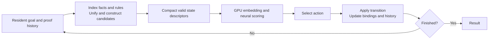
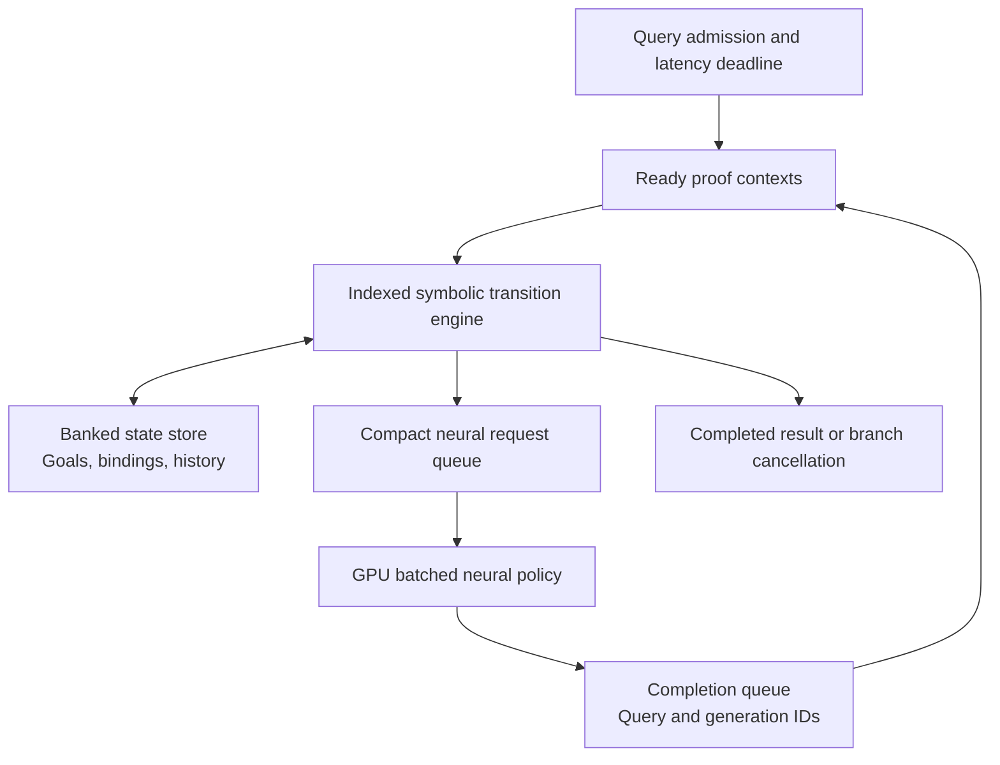

# Efficient execution of neural-guided dynamic proofs

Research proposal and GPU baseline investigation, 2026-10-09.

**Recommendation:** investigate a runtime and architecture that keep symbolic
proof state resident, generate only applicable work, and batch neural requests
across independent queries. Treat a REASON extension as one implementation
candidate. The evidence does **not** justify the premise that GPUs cannot solve
this problem: the GPU implementation has substantial avoidable work, and that
work must be removed before claiming a hardware advantage.

This proposal concerns inference with a frozen policy. Its initial execution
contract is DPrL's existing bounded KG rollout, with the same ordered candidates,
state transitions, checkpoint, and answer outputs. Faster training, a better
search algorithm, and a universal formal-proof accelerator are separate claims.

## 1. The problem

For a current goal state, the DPrL KG implementation enumerates applicable facts
and rules, performs unification and substitution, and constructs candidate next
states. A neural policy embeds and scores those states. The selected action
updates the goal, variable bindings, proof history, termination status, and the
next candidate set. This repeats until completion or the step budget expires.
[DPrL](https://arxiv.org/abs/2511.08581).

The computational graph of a neural layer is regular. The *sequence and volume*
of proof work are data dependent. Different queries expose different candidate
counts and terminate at different depths. A fixed rectangular batch makes
compilation convenient but may execute large amounts of masked work.

The earlier GPU trace illustrates this mismatch: only 2.28% of allocated Family
candidate slots and 0.354% of WN18RR slots were valid for active queries across
20 rounds; only about 28-29% of query lanes remained active on average. These
are **measured counts for the earlier batches**, not universal workload
constants. The newer corrected WN18RR implementation must be measured
independently. [Original trace and qualifications](../RESULTS_20261009.md).

Three distinct problems must not be collapsed into one explanation:

1. **Unnecessary work:** scoring padded candidates and deriving successors for
   completed queries. Software can remove much of this.
2. **Implementation overhead:** launch/dispatch costs, shape synchronization,
   repeated state gathers, and contended scatter operations. Software can also
   reduce these substantially.
3. **Remaining execution constraints:** serial dependencies along a proof path,
   small and uneven ready sets, symbolic-state access, and the cost of moving
   work between execution engines. These motivate an architecture study only
   after the first two have been addressed.

## 2. Why the problem has broader relevance

The [literature review](LITERATURE.md) and [paper inventory](papers.tsv) identify
36 distinct papers: 18 neural-guided proof methods, six adjacent search or
generation methods, four neighboring controls, six systems/architecture papers,
and two surveys. The **24 direct or adjacent method papers** establish a
recurring workload family; the total is a curated inventory rather than a
complete bibliometric count. Twelve of the 18 direct proof papers first
appeared from 2023 onward.

The recurring pattern is learned proposal/scoring, symbolic execution or
verification, and feedback into the next search decision. It appears in
[TacticZero](https://arxiv.org/abs/2102.09756),
[HyperTree Proof Search](https://arxiv.org/abs/2205.11491),
[LeanDojo](https://arxiv.org/abs/2306.15626),
[AlphaGeometry](https://www.nature.com/articles/s41586-023-06747-5), and
[AlphaProof](https://www.nature.com/articles/s41586-025-09833-y), with related
patterns in graph traversal and constrained program generation. This is an
important active approach within automated reasoning; the inventory does not
show that it dominates all AI or all neuro-symbolic computing.

The generalizable object is initially a **state-transition and scheduling
interface**. Hardware generality must be tested separately: DPrL unification,
Lean elaboration, geometric closure, and graph adjacency require different
operations. Large language models may dominate other provers' runtime even
when DPrL's small MLP does not. A dynamic-programming or compiled-circuit NeSy
workload is also a useful negative control rather than automatic evidence for
the same bottleneck.

## 3. Optimized GPU baseline and evidence

The executable experiment uses a real RTX A5000 on Slurm `athena/node2`, strict
FP32, TF32 disabled, batch 64, and the unchanged 20-step limit. It compares a
compiled native implementation and a complete CUDA Graph control with online
candidate/query compaction, bucketed CUDA Graphs, and contention-free candidate
packing. Compaction decisions come from live GPU state every invocation; their
host synchronization and input-copy costs are included.

Both datasets use the deterministic first-K candidate correction. Expanded
WN18RR testing exposed the upstream scatter race that had already affected
Family. The optimized kernel preserves that correction's exact fact-then-rule
order and capacity. A changed answer is not accepted as a speedup.

Correctness requires matching active actions, all retained persistent proof
states at every round, final successes/depths, and repeated output hashes.
Valid logits are checked with an explicit numerical tolerance because combining
the same FP32 MLP rows into a different batch can change reduction roundoff.
Three disjoint batches per dataset are evaluated. The checkpoints are short
profiling checkpoints, **not reproductions of the paper's converged accuracy**.
Their identity is held fixed throughout each comparison.

The [optimized measurements and profiling report](GPU_RESULTS.md) record the
following complete batch latencies. Values are measured means of three batch
medians, with 20 repetitions for each of the three disjoint batches; speedups
are derived ratios.

| Workload | Corrected compiled GPU | Complete graph control | Best tested GPU | Speedup vs graph |
|---|---:|---:|---:|---:|
| Family | 52.396 ms | 46.092 ms | **14.975 ms** | **3.08x** |
| WN18RR | 97.978 ms | 95.280 ms | **24.623 ms** | **3.87x** |

Family is fastest when only neural inputs are compacted; WN18RR benefits from
also compacting active queries and compiling the associated state gathers.
Both use the fast exact candidate-packing kernel and per-shape graphs. All
tested active actions and retained proof states match the corrected controls.
The remaining environment spans are approximately 9.5 and 11.8 ms in separate
instrumented runs, while WN18RR additionally spends about 6.9 ms discovering
active indices and packing state. These are diagnostics, not a claim that those
entire spans are intrinsically unaccelerable GPU work.

Nsight launch-correlated attribution places **62.0% / 68.1% of captured kernel
time** in environment transitions, versus **17.6% / 9.1%** in neural SGEMMs.
Selected invalid-state padding writes reach **89.1% / 91.6% DRAM throughput**
in hardware-counter samples. This identifies a concrete remaining problem:
the unifier still materializes many fact-pair states that are subsequently
masked or replaced. It supports investigating earlier indexing and state
locality; it does not prove a GPU cannot implement those improvements.

Their interpretation must distinguish complete batch
latency, instrumented phase spans, and summed kernel time; these are different
quantities.

## 4. Why GPU optimization does not settle the architecture question

There is no demonstrated GPU impossibility result. GPUs support irregular
execution, and dynamic scheduling is established software research:
[Atos](https://arxiv.org/abs/2112.00132) and
[TreeThink](https://arxiv.org/abs/2607.11258) are relevant prior art. The practical
question is whether, at a given query arrival rate and latency target, the
remaining transitions can be executed more efficiently by specialized support.

| Constraint | What GPU software can do | What could remain, and needs evidence |
|---|---|---|
| Padded candidates | Compact exact valid work; fuse neural rows | Cost of discovering and packing the valid set |
| Finished queries | Compact active lanes or refill them | Tail queries offer little parallel work under a latency deadline |
| Many small kernels | Compile, capture graphs, fuse transitions, use persistent kernels | Synchronization and irregular state access inside the fused execution |
| Candidate lookup | Predicate/argument indexes, sparse storage, better GPU joins | Dependent accesses and hot-key contention at realistic sizes |
| Neural/symbolic handoff | Device-resident queues and asynchronous batching | Queue latency, state movement, and ownership/consistency costs |
| A dependent proof path | Schedule independent queries or branches | The next state still depends on the selected and executed action |

The last dependency is not removed by an accelerator either. Hardware may
shorten each transition and overlap *independent* work. It cannot execute an
unknown next action with zero dependency cost. Conversely, enough concurrent
queries may make a GPU-only runtime highly efficient. Evaluate low-latency and
high-throughput regimes separately.

Further GPU work remains possible, especially argument-indexed candidate
generation and a persistent execution loop without host `nonzero` shape
synchronization. The present optimized implementation is a substantially
stronger baseline, not a measured GPU performance ceiling. An architecture
paper must compare against these mechanisms, including equivalent software
work reduction.

## 5. What to add beyond existing REASON

REASON already provides watched-literal indexing, implication queues, memory
overlap, and conflict cancellation for SAT. “Add a dynamic queue” is therefore
insufficient novelty. The proposed extension concerns goal-dependent creation
and evolution of **first-order proof state**, plus efficient coordination with
neural scoring. [REASON Sections V-D/V-E](https://arxiv.org/html/2601.20784v1).

The current repository reconstruction is not the authors' simulator. Its KG
mapping offloads only the final policy dot products; it leaves unification,
candidate generation, state history, the MLP, and normalization on the GPU.
Those dot products represented only about 0.6-0.7% of the earlier captured GPU
kernel time. The mapping therefore targets a very small fraction of the work.
Its modeled load waits and output-bank imbalance also depend on simplified
scheduler and allocation choices. They are reasons to improve the model, not
evidence that the original REASON hardware has those limitations.
[Reconstruction](../RECONSTRUCTION.md), [measured/modelled breakdown](../RESULTS_20261009.md).

| Proposed mechanism | Concrete function | Required comparison |
|---|---|---|
| Goal-indexed work generation | Probe predicate and bound-argument indexes; dispatch only applicable rule/fact descriptors | Same indexes on the GPU; charge index construction and storage |
| Resident proof contexts | Store goals, substitutions, variable namespaces, history and continuation IDs near execution | Compact GPU state pools with equivalent capacity and semantics |
| Programmable symbolic transitions | Match/unify, bind, substitute, compact and update history; retain reusable rule templates | Fused GPU kernels and a persistent GPU interpreter |
| Neural request batching | Send compact IDs/features for scoring; keep the neural network on the GPU | GPU-only asynchronous batching with identical deadlines |
| Safe asynchronous execution | Track query/generation IDs, completion, bounded queues, cancellation and backpressure | Existing REASON dynamic mechanisms and software task queues |

This is a **hypothesized design**, not implemented accelerator RTL. Avoid
hardwiring every prover into an SLD data path. A useful first prototype has a
common queue/context interface and pluggable transition templates; only kernels
shown to recur should become dedicated units.

State residency is the central hypothesis. Sending complete embedding vectors
or materialized candidate tensors across the boundary every round could erase
the benefit. The prototype must account for the actual interface: a loosely
coupled PCIe device and an on-package/shared-cache design have different costs.
Neither zero-copy nor cache coherence should be assumed without implementing
and charging the mechanism.

Finite resources are part of the design: measure state allocation/reclamation,
bank conflicts, queue occupancy, history spills, index misses, and stale-result
cancellation. Preserve candidate order where the algorithm depends on it. A
hash-history check must not silently become exact set membership, and an
approximate pruning policy must be evaluated separately at matched quality.

## 6. Experiments that can support or reject the proposal

1. **Complete the software floor.** Add indexed candidate generation and a
   persistent GPU loop to the supplied optimized baseline. Measure isolated
   queries and request streams, batch sizes, proof depths, candidate skew,
   knowledge-base sizes, and state-history capacity. Use converged checkpoints
   for application-level conclusions.
2. **Test workload transfer.** Retain Family/WN18RR as two datasets within one
   execution family. Add neural graph/path search and a proof-assistant search
   workload. Measure their actual symbolic kernels before promising a common
   data path. Keep the MNIST dynamic-programming example as a regular control.
3. **Build a bounded functional model.** Implement exact goal transitions and
   descriptor queues with finite SRAM, ports, capacities, and backpressure.
   Replay live neural decisions or integrate the neural policy; an offline trace
   must not supply future work to an online scheduler.
4. **Calibrate timing and cost.** Validate operator timing, bank behavior, and
   interface transfers against RTL/microbenchmarks or another justified source.
   Repair the reconstruction's serialization and bank-allocation artifacts
   before calling it a REASON comparison. Published constants and assumed
   constants must be distinguishable; unsupported values remain `TBD[src]`.
5. **Run matched comparisons and ablations.** Compare optimized GPU-only,
   supported-operator REASON, and the proposed extension. Remove indexing,
   state residency, asynchronous queues, and cross-query batching one at a time.
   Charge CPU work, transfers, queueing, and result completion. Report median
   and tail latency, throughput, accuracy, energy, area, and total memory.

Use a critical-path budget before committing to hardware. If fraction `f` of
optimized end-to-end time is actually replaceable, an ideal accelerator with no
new overhead has the optimistic limit `1 / (1 - f)`. A practical system must
also pay interface and scheduling costs. Instrumented phase spans provide
diagnostics; kernel-time percentages alone do not identify `f`.

The architecture succeeds only if an implemented and calibrated mechanism
improves a defined latency/throughput/energy target over the strongest matched
GPU baseline on more than one execution family. If indexing and persistent GPU
execution remove the remaining gap, the defensible contribution is a GPU
runtime/workload paper. If gains require changed proof budgets or speculative
zero-cost transfers, the hardware proposal should be rejected or narrowed.

## Deliverables and evidence

- [Literature scope and trend analysis](LITERATURE.md) and [36-paper inventory](papers.tsv).
- [Optimized GPU measurements, correctness and reproduction](GPU_RESULTS.md).
- [Original GPU/REASON experiment report](../RESULTS_20261009.md), with GPU
  measurements separated from uncalibrated hardware estimates.
- GPU implementations: [online compaction](../scripts/optimize_kg.py),
  [bucketed graphs](../scripts/optimize_kg_graphs.py),
  [contention-free packing](../scripts/fast_candidates.py), and
  [combined experiment](../scripts/optimize_kg_fast.py).
- [GPU packing correctness checks](../scripts/check_fast_candidates.py) and
  [profiler runner](../scripts/profile_optimized.sbatch).
